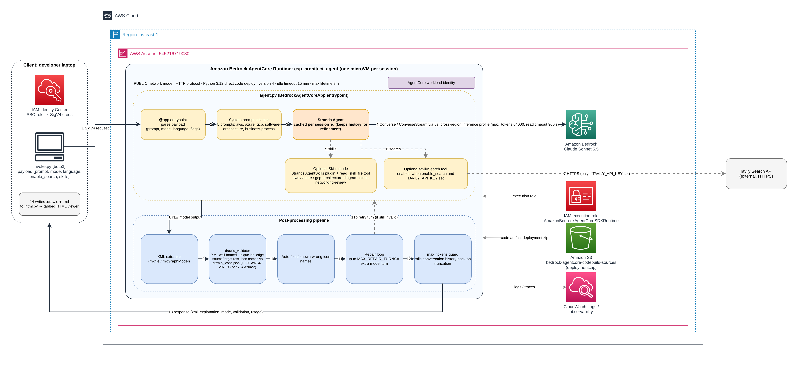

# CSP Architect Agent (Diagram Generator on AgentCore)

The **Diagram Generator** agent from [aws-samples/bedrock-engineer](https://github.com/aws-samples/bedrock-engineer)
(`src/renderer/src/pages/ChatPage/constants/DEFAULT_AGENTS.ts` + `DiagramGeneratorPage/utils/xmlParser.ts`),
ported to a Strands agent running on Amazon Bedrock AgentCore Runtime.

- `agent.py` – AgentCore entrypoint; returns `{"xml", "explanation", "mode", "validation"}`
- `prompts/` – system prompts for 5 modes: `aws`, `azure`, `gcp` (CSP diagrams with verified icon names),
  plus the original `software-architecture` and `business-process`
- `drawio_validator.py` + `drawio_icons.json` – validates every diagram (well-formed XML, cell references,
  icon names that exist in draw.io) and auto-fixes known-wrong icon names
- `skills/` – Agent Skills for skills mode (`"skills": true`): the official AWS `aws-architecture-diagram` skill
  (vendored from awslabs/agent-plugins), plus `azure-architecture-diagram`, `gcp-architecture-diagram` and
  `strict-networking-review`
- `evals/` + `scripts/ab_compare.py` – strict-networking use cases, a requirement rubric, and an A/B runner
  (prompt mode vs skills mode)
- `invoke.py` – client that calls the deployed runtime and writes a `.drawio` file (+ `.md` explanation)
- `gateway/` + `tools_gateway.py` – private ingress: PrivateLink → AgentCore Gateway (Cognito JWT) → runtime
  (IAM only), with the caller's alias passed to web search and a post-processing hook Lambda. See
  [gateway/README.md](gateway/README.md)
- `doc_agent.py` (`coe_agent.py`, `aicoe_agent.py`), `terraform_agent.py`, `portal/`, `templates/` – three more portal
  agents (Cloud CoE / AI CoE documents, Terraform) with DynamoDB sessions, 90-day uploads and results published as
  merge requests. See [docs/portal-agents.md](docs/portal-agents.md)
- `to_html.py` – bundles `.drawio` files into one tabbed HTML page for demos (draw.io viewer, needs internet)

## Payload
```json
{"prompt": "...", "mode": "aws | azure | gcp | software-architecture | business-process", "language": "English", "enable_search": false, "async": false}
{"action": "status", "job_id": "..."}      // poll an async job: RUNNING | SUCCEEDED | FAILED | LOST
```

## Diagram validation
Each reply is checked before it is returned:
1. The XML must parse as a draw.io document (multi-page and compressed pages are supported). Cell ids must be
   unique, and every parent / edge source / edge target must exist.
2. Every icon must exist in draw.io's own libraries (`drawio_icons.json`: 1,050 AWS4 icons, 297 GCP2 icons,
   704 Azure2 images). An unknown name renders as a blank shape, e.g. `mxgraph.aws4.elastic_container_registry`
   instead of `mxgraph.aws4.ecr`.
3. Known-wrong names are rewritten automatically (`validation.auto_fixed`). Anything else gets up to
   `MAX_REPAIR_TURNS` (default 1, `0` disables) extra model turns with the exact list of problems.

The response carries `validation: {ok, errors, icon_errors, pages, vertices, edges, auto_fixed, repair_turns}`.
If the model hits `max_tokens`, the runtime returns `{"error": ..., "error_code": "max_tokens"}` instead of a 500,
and a reused session's history is rolled back. The CSP prompts ask for one page per concern (network / workloads /
MLOps) once a diagram passes about 60 icons, which keeps large architectures inside the output limit.
Refresh the icon registry with `scripts/dump_drawio_icons.py` when draw.io adds shapes.

## Skills mode (A/B against the per-mode prompt)
With `"skills": true` (or `USE_SKILLS=true` as the default) for the `aws`, `azure` and `gcp` modes, the agent starts from a
short headless prompt (`prompts/skills_runtime.md`) and loads skills on demand through Strands' `AgentSkills` plugin:
the `skills` tool returns a skill's instructions, and `read_skill_file` (confined to `skills/`, no `.drawio` examples)
reads only the references that skill asks for. Validation, auto-fix and the max_tokens handling are the same in both modes.
The response adds `usage` (tokens, model/tool calls, skills activated, files read) so the two modes can be compared:

```bash
python agent.py                                   # terminal 1: local server
python scripts/ab_compare.py --repeat 2           # terminal 2: 3 use cases x 2 variants x 2 runs
python scripts/ab_compare.py --runtime            # or against the deployed runtime
```
Results go to `evals/results/<timestamp>/` (`summary.md`, `results.json`, every diagram). After refreshing the icon
registry, run `python scripts/build_icon_catalogs.py` to regenerate the Azure/GCP skill catalogs.

## Configuration
`enable_search` uses the tools gateway's web-search connector when `TOOLS_GATEWAY_URL` is set (gateway mode),
otherwise it requires a `TAVILY_API_KEY` env var on the runtime. The model defaults to
`us.anthropic.claude-sonnet-5-5` (override with `MODEL_ID`), with `max_tokens` 64000
(override with `MAX_TOKENS`). If you reuse the same runtime session ID,
the agent keeps the conversation history, so a follow-up message can refine the previous diagram.

## Commands
```bash
uv venv -p 3.12 && source .venv/bin/activate
uv pip install bedrock-agentcore strands-agents bedrock-agentcore-starter-toolkit pyyaml boto3
agentcore configure -e agent.py -n csp_architect_agent -r us-east-1 -rf requirements.txt \
  -dt direct_code_deploy -rt PYTHON_3_12 -dm -ni
agentcore deploy                      # deploy / redeploy after changes
python invoke.py "Serverless app with API GW, Lambda, DynamoDB" aws
python invoke.py "Hub-spoke vWAN with ExpressRoute and private AKS" azure -o azure-hub-spoke
python invoke.py "GKE behind global ALB with PSC to Vertex AI" gcp --language "Traditional Chinese"
agentcore invoke '{"prompt": "3-tier web app on EC2 with RDS"}'
pip install markdown && python to_html.py demo.html diagram-*.drawio --title "My Architectures"
agentcore destroy                     # remove all AWS resources
pip install -r requirements-dev.txt && pytest -q   # offline tests, no AWS needed
```
`invoke.py` names outputs `diagram-<mode>-<timestamp>` (or `-o NAME`) so runs never overwrite each other.

## Gateway mode (private, JWT at the edge, IAM inside)
```bash
python gateway/deploy.py --vpc-id vpc-0abc --subnet-ids subnet-aaa,subnet-bbb
python gateway/deploy.py --update-runtime-only     # after every `agentcore deploy`
python gateway/client.py --all-checks              # from inside the VPC, as user yhtsao
```
Runtime env vars set by `deploy.py`: `TOOLS_GATEWAY_URL`, `REQUIRE_CALLER_ALIAS=true`, `WEB_SEARCH_TARGET`,
`HOOK_TARGET` (optional `HOOK_REQUIRED=true`), and `ASYNC_DEFAULT=true` + `JOB_BUCKET`. A gateway call ends after
15 minutes, so every request becomes a job: `{"job_id"}` comes back at once, and the client polls
`{"action": "status", "job_id": ...}`. Details, the security checks and the verify list are in
[gateway/README.md](gateway/README.md).

## Examples
`examples/` holds end-to-end MLOps architectures for AWS, GCP and Azure generated by this agent
(`.drawio` + explanation), bundled into `examples/mlops-architectures.html`. Download the HTML and open
it in a browser to demo all three as tabs (GitHub shows HTML as source, not as a page).
`examples/csp-agent-architecture.*` is this agent's own architecture (AgentCore Runtime, Strands, Bedrock,
validation pipeline), drawn by the agent itself; open `csp-agent-architecture.html` the same way.


