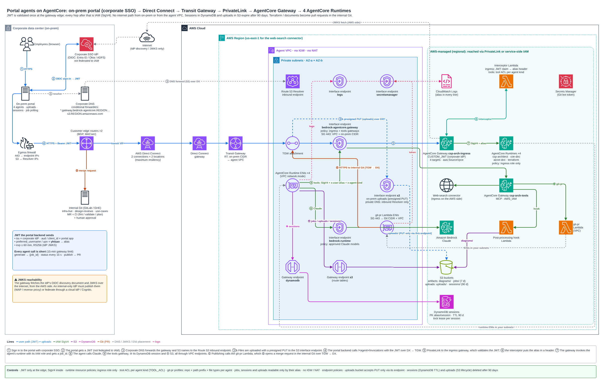
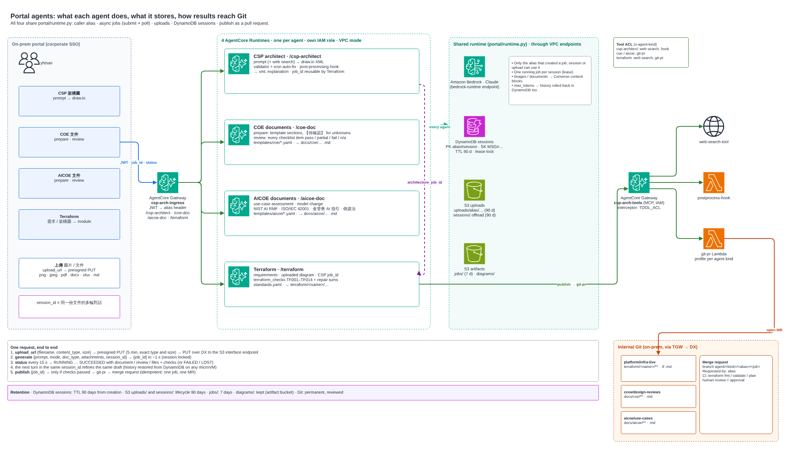

# Portal agents: COE documents, AICOE documents, Terraform

The on-prem portal reaches three more agents next to the CSP architect agent. All four are behind the same private
ingress (PrivateLink → AgentCore Gateway, JWT from the corporate IdP, IAM inside); see
[gateway/README.md](../gateway/README.md) for that path.

| Agent | Target | What it does | Output |
|---|---|---|---|
| CSP architect | `/csp-architect` | prompt → draw.io architecture (existing) | `.drawio` + explanation |
| **COE documents** | `/coe-doc` | **prepare** a Cloud CoE document from the template, or **review** one against the CoE checklist | `docs/coe/…md` / review report |
| **AICOE documents** | `/aicoe-doc` | same for the AI CoE (AI use-case assessment, model change) | `docs/aicoe/…md` / review report |
| **Terraform** | `/terraform` | requirements, an uploaded diagram, or a CSP architect `job_id` → a Terraform module that passes the static checks | `terraform/<name>/…` |




The editable source is [architecture/portal-agents-architecture.drawio](architecture/portal-agents-architecture.drawio)
(two pages), regenerated with `scripts/draw_portal_architecture.py`.

## Design decisions
- **One AgentCore Runtime per agent.** Each has its own IAM role, deploy cycle and scaling. Only the Terraform
  runtime can reach the infrastructure repository profile, and a bug in one agent can't take the others down. All
  share `portal/runtime.py`.
- **Templates are data.** `templates/coe|aicoe/templates.yaml` (doc types, required headings, guidance) and
  `checklist.yaml` (review items with severity and doc types). The same files build the prompt *and* validate the
  output: a draft missing a required heading, or a review that leaves a checklist item without a status, gets a
  repair turn and is not publishable until it passes. Replace the shipped defaults with your CoE's own templates.
- **Unknowns are never invented.** Drafts mark missing facts as `【待確認】` and list them in `open_questions`. The
  portal can show these and send the answers as the next turn in the same session.
- **Terraform is checked here, proven in CI.** `terraform_checks.py` parses every file (python-hcl2) and enforces
  the baseline in `templates/terraform/standards.yaml`: pinned versions, S3 backend with locking, required
  default tags, no credentials, no 0.0.0.0/0 ingress, no IGW / NAT, encryption, IMDSv2, KMS rotation. A justified
  exception is a visible `# tfcheck:allow TFxxx <reason>` comment. `terraform validate / plan` and human review
  happen in the repository's CI on the merge request. The agent has no cloud credentials for the target accounts.
- **Results become merge requests, not commits.** `{"action": "publish", "job_id"}` calls the `git-pr` tool (a
  Lambda target on the tools gateway, VPC-attached, reaching GitLab / GitHub Enterprise over TGW → DX):
  - branch `agent/<kind>/<alias>/<job>`;
  - a `Requested-by` trailer;
  - idempotent (one job, one MR);
  - only when the checks passed.
  Each agent kind has a profile in `gateway/agents.yaml` (repository, base branch, path prefix, file types), so an
  agent can't choose where it writes.
- **Tool ACL.** The tools-gateway interceptor allows each agent kind only its own targets (`TOOL_ACL`, built from
  `agents.yaml`): CSP architect gets web search + hook, COE / AICOE get git-pr, Terraform gets web search + git-pr.
  The kind travels in `x-agent-kind`, set by agent code, never by the model. For IAM-level separation between
  agents, give each agent its own tools gateway: the trade-off is more gateways to operate.

## Sessions in DynamoDB
A gateway call can land on any runtime microVM, so a multi-turn conversation (refining a draft, answering open
questions) is stored by `portal/sessions.py`, a Strands `SessionRepository` on one DynamoDB table:

| Item | Key |
|---|---|
| session | `PK = <alias>#<session_id>`, `SK = SESSION` |
| agent state | `SK = AGENT#<kind>` |
| messages | `SK = MSG#<kind>#<00000042>` |
| running-job lock | `SK = LOCK` (lease renewed by the job heartbeat) |

- **Scoped by alias:** the partition key starts with the caller's alias from the JWT, so the same `session_id` from
  another user is a different, empty conversation.
- **Expiry:** `expires_at` is the table's TTL attribute, set once when the session is created (`SESSION_TTL_DAYS`,
  default 90), so the whole conversation expires together. Expired items are ignored on read, even before DynamoDB
  deletes them.
- **Large items:** items over ~300 KB (long documents, image bytes in the history) are offloaded to
  `s3://<uploads bucket>/sessions/…`. That prefix has the same 90-day lifecycle rule.
- **One job at a time:** only one job runs per session. A second request gets `session_busy`. If a microVM dies,
  the lease frees the session within 5 minutes.
- **Output limit:** a `max_tokens` turn is rolled back in DynamoDB as well as in memory.

## Uploads (images, documents) in S3 for 90 days
1. `{"action": "upload_url", "filename", "content_type", "size"}` returns a presigned PUT for
   `uploads/<alias>/<yyyy>/<mm>/<dd>/<id>/<name>`. It is valid for 5 minutes and bound to that content type and exact size.
   - Images: png, jpeg, gif, webp (≤ 3.75 MB).
   - Documents: pdf, docx, doc, xlsx, xls, csv, md, txt, html (≤ 4.5 MB). These are the Bedrock Converse limits.
2. The portal PUTs the file over DX to the **S3 interface endpoint**:
   - its private DNS answers only queries from the inbound Resolver, so on-prem resolves the bucket host to the
     endpoint, while workloads inside the VPC keep using the S3 gateway endpoint;
   - the bucket policy denies `PutObject` on `uploads/*` that doesn't come through that endpoint.
3. `{"prompt", "attachments": [key, …]}`: the runtime checks every key is under the caller's own prefix, checks
   the file signature, and passes images / documents to Claude as Converse content blocks.
4. Lifecycle rule: `uploads/` and `sessions/` expire after 90 days (`retention` in `gateway/agents.yaml`).

## API (all agents)
```jsonc
{"prompt": "...", "mode": "prepare|review", "doc_type": "solution-design", "title": "payments-gateway",
 "attachments": ["uploads/yhtsao/..."], "session_id": "pay-2026-001"}     // -> {"job_id", "status": "RUNNING"}
{"action": "status", "job_id": "..."}        // -> RUNNING | SUCCEEDED (document / review / files + checks) | FAILED | LOST
{"action": "upload_url", "filename": "board.jpg", "content_type": "image/jpeg", "size": 183422}
{"action": "publish", "job_id": "...", "title"?: "...", "description"?: "..."}   // -> {"pull_request": {"url", ...}}
```
Terraform also takes `"architecture_job_id"`: the CSP architect job whose diagram (summarised to a component /
connection list) should be implemented. Only the same alias's successful jobs can be used.

## Deploy
```bash
# 1. one runtime per agent (VPC network mode is applied by deploy.py --runtime-vpc)
agentcore configure -e coe_agent.py       -n coe_doc_agent   -r us-east-1 -rf requirements.txt -dt direct_code_deploy -rt PYTHON_3_12 -dm -ni
agentcore configure -e aicoe_agent.py     -n aicoe_doc_agent -r us-east-1 -rf requirements.txt -dt direct_code_deploy -rt PYTHON_3_12 -dm -ni
agentcore configure -e terraform_agent.py -n terraform_agent -r us-east-1 -rf requirements.txt -dt direct_code_deploy -rt PYTHON_3_12 -dm -ni
agentcore deploy -a coe_doc_agent && agentcore deploy -a aicoe_doc_agent && agentcore deploy -a terraform_agent

# 2. Git bot token (project / repo scoped) for the git-pr Lambda; edit gateway/agents.yaml (git server, repos, CIDRs)
aws secretsmanager create-secret --name csp-arch/git-token --secret-string '<token>'

# 3. gateway, targets, table, buckets, Lambdas, endpoints, policies
python gateway/deploy.py --vpc-id vpc-0abc --subnet-ids subnet-aaa,subnet-bbb --client-cidr 10.10.0.0/16 \
  --runtime-vpc --discovery-url https://login.microsoftonline.com/<tenant>/v2.0/.well-known/openid-configuration \
  --allowed-audience api://portal-agents
python gateway/deploy.py --update-runtime-only --runtime-vpc    # after every `agentcore deploy`
```
On-prem DNS needs conditional forwarders to the Route 53 inbound endpoint for
`gateway.bedrock-agentcore.<region>.amazonaws.com` and `s3.<region>.amazonaws.com`.

## Try it
```bash
export CSP_TOKEN=<access token from your SSO>          # or use the Cognito test user from deploy.py
python gateway/portal_client.py coe --doc-type solution-design --attach whiteboard.jpg --session pay-2026-001 \
    "新的支付閘道上雲，需要 DX 備援與 PrivateLink，RTO 1 小時"
python gateway/portal_client.py coe --doc-type solution-design --session pay-2026-001 "補上成本估算，月預算 8000 USD"
python gateway/portal_client.py aicoe --mode review --doc-type use-case-assessment --attach proposal.docx "請依檢核表審查"
python gateway/portal_client.py terraform --architecture-job <csp job_id> --title payments-network "network layer" --publish
python gateway/portal_client.py checks coe            # foreign attachment / busy session / foreign job / bad upload type
```

## Verify on the first deploy
Not run against AWS yet (offline tests only). Check these:
1. **`networkConfiguration` VPC mode via `update_agent_runtime`.** Confirm the runtime ENIs appear in the
   subnets, and that Bedrock / S3 / DynamoDB / tools-gateway calls succeed with no NAT.
2. **S3 interface endpoint with `PrivateDnsOnlyForInboundResolverEndpoint`.** The S3 gateway endpoint must
   exist first. Test a presigned PUT from on-prem, and confirm that one from the internet is denied.
3. **`metadataConfiguration.allowedRequestHeaders` on the git-pr Lambda target.** Both `x-user-alias` and
   `x-agent-kind` must reach the Lambda, or it rejects the call.
4. **JWT claims from your IdP.** `ALIAS_CLAIMS` on the interceptor (default
   `alias,username,cognito:username,preferred_username,upn`), and `allowedAudience` vs `allowedClients` for your
   token type.
5. **Gateway response size.** A finished job returns the full document or module in the status response (6 MB
   gateway limit). Very large Terraform outputs should be split.
