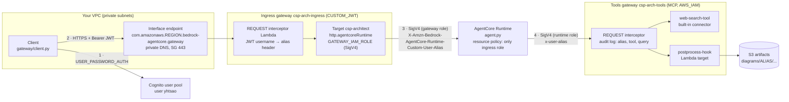

# Private gateway ingress (PrivateLink → AgentCore Gateway → Runtime)

This mode puts the CSP architect agent behind an AgentCore Gateway that is reachable only through a VPC interface
endpoint. A user signs in with Cognito, and the JWT is checked once, at the gateway. Every hop after that uses IAM
(SigV4 with a role). The runtime accepts calls only from the gateway's role. The user's login alias (for example
`yhtsao`) is read from the token and passed along in headers to the agent, the web search tool and the
post-processing hook, which use it for logging.



## How a request flows

| Hop | Authentication | How the alias travels |
|---|---|---|
| Client → VPC endpoint → ingress gateway | Cognito **access token** (`CUSTOM_JWT`: discovery URL + `allowedClients`; optional `customClaims` on `username` with `--allowed-alias`) | `username` claim inside the JWT |
| Interceptor (ingress) | The gateway invokes the Lambda with its own role | Decodes the already-verified token and writes `X-Amzn-Bedrock-AgentCore-Runtime-Custom-User-Alias`. It overwrites any header with that name the client sent, and drops `Authorization`. A token with no usable alias gets a 403 before the runtime is called. |
| Ingress gateway → runtime | **IAM**: the gateway role signs `InvokeAgentRuntime` (`GATEWAY_IAM_ROLE`, service `bedrock-agentcore`) | The header is on the target's `allowedRequestHeaders` and the runtime's `requestHeaderAllowlist`. The agent reads it from `context.request_headers`. |
| Runtime → tools gateway | **IAM**: the runtime role signs MCP calls (`AWS_IAM` inbound, `bedrock-agentcore:InvokeGateway` on that one gateway) | `x-user-alias` header (`tools_gateway.py`) |
| Tools gateway → web search / hook Lambda | **IAM**: the tools gateway role (`InvokeWebSearch`, `lambda:InvokeFunction`) | The interceptor logs `{alias, tool, query}`. The hook target propagates `x-user-alias`, and the Lambda reads it from `context.client_context.custom["bedrockAgentCorePropagatedHeaders"]`. |

The post-processing hook runs **deterministically** after the agent produces a diagram. It is not a tool the model
decides whether to call. It validates the diagram, fixes icon names, stores `.drawio` and `.md` under
`s3://csp-arch-artifacts-ACCOUNT-REGION/diagrams/ALIAS/YYYY/MM/DD/`, and writes a JSON log line. The response
gets `postprocess: {ok, artifact, alias, validation_ok}` and `caller: {alias}`. A hook failure is reported in
`postprocess.error` and the diagram is still returned. Set `HOOK_REQUIRED=true` on the runtime to make it fatal.

### Why there are two gateways
An AgentCore Runtime target (`http.agentcoreRuntime`) needs a gateway with no MCP protocol type, while Lambda and
connector targets need an MCP gateway. Keeping them apart also separates the trust boundaries: the ingress
gateway trusts users (JWT), and the tools gateway trusts only the runtime role (IAM).

### What locks the path down
- **Network:** the ingress gateway resource policy allows `InvokeGateway` only when `aws:SourceVpce` equals the
  endpoint, and explicitly denies everything else. The endpoint policy allows only our two gateway ARNs.
- **Runtime:** a resource policy on the runtime and on `runtime-endpoint/DEFAULT` allows the ingress gateway role
  and denies every other principal (`ArnNotEquals aws:PrincipalArn`). Your own `agentcore invoke` and
  `invoke.py` calls are denied too. Use `--allow-invoke-principal ARN` for a break-glass role.
- **Agent:** `REQUIRE_CALLER_ALIAS=true` makes the agent refuse requests that arrive without the alias header.
- **Roles:** each gateway role trusts `bedrock-agentcore.amazonaws.com` only with `aws:SourceAccount` set and
  `aws:SourceArn` set to that exact gateway. The Lambda role can only `PutObject` under `diagrams/`. The bucket
  blocks public access and accepts TLS only.

## Deploy
Prerequisites: the runtime is deployed (`agentcore deploy`, so `.bedrock_agentcore.yaml` has its ARN). You also need
a VPC with private subnets in two AZs and admin-level credentials for IAM, Lambda, Cognito, EC2 and AgentCore.
Use **us-east-1**, where the web-search connector is available.

```bash
pip install boto3 pyyaml
python gateway/deploy.py --vpc-id vpc-0abc --subnet-ids subnet-aaa,subnet-bbb      # prints the yhtsao password once
# optional: --allowed-alias yhtsao        only this username passes the gateway authorizer
#           --security-group-id sg-...    reuse a security group for the endpoint ENIs
#           --skip-vpc                    everything except the endpoint and the aws:SourceVpce policy (testing only)
```
The script is idempotent: re-running it updates the existing resources. State goes to `gateway/.deploy-state.json`
(git-ignored).

> **After every `agentcore deploy`, run `python gateway/deploy.py --update-runtime-only`.** The starter toolkit
> resets the runtime's environment variables and request header allowlist. Without this step the agent stops
> seeing the alias and stops calling the tools gateway.

## Test (from inside the VPC)
Run from an EC2 instance, Cloud9 or a CloudShell VPC environment in a subnet that can reach the endpoint. The
host also needs to reach Cognito, through a NAT gateway or a `cognito-idp` interface endpoint.

```bash
export CSP_TEST_PASSWORD='...'                     # printed by deploy.py
python gateway/client.py --all-checks              # security checks + one diagram
python gateway/client.py "Hub-spoke vWAN with ExpressRoute and private AKS" --mode azure --search
```

`--all-checks` expects:

| # | Check | Expected |
|---|---|---|
| 1 | Cognito login as `yhtsao` | access token with `username=yhtsao` |
| 2 | Gateway call with the JWT | HTTP 200, `caller.alias == yhtsao`, `postprocess.ok`, the hook saw `yhtsao` |
| 3 | No token | 401/403 |
| 4 | Token with a forged signature | 401/403 |
| 5 | Direct `InvokeAgentRuntime` with your IAM credentials | `AccessDenied` |

Run the same call from outside the VPC (your laptop, say) and it should get 403 from the `aws:SourceVpce`
policy.

To check the alias in the logs, run this CloudWatch Logs Insights query on `/aws/lambda/csp-arch-alias-interceptor`
and `/aws/lambda/csp-arch-postprocess-hook`:
```
fields @timestamp, component, gateway, decision, alias, tool, query, artifact
| filter alias = 'yhtsao' | sort @timestamp desc
```

## Clean up
```bash
python gateway/cleanup.py                 # endpoint, policies, both gateways, Lambdas, roles, bucket, user pool
python gateway/cleanup.py --keep-cognito --keep-bucket
```
The runtime itself stays. Remove it with `agentcore destroy`.

## Verify on first deploy
Each item below is based on the AgentCore documentation as of 2026-10, but has not been run against a live
account from this repo:
1. **`aws:SourceVpce` in the gateway resource policy.** The docs describe it only in prose. If check 2 fails
   from inside the VPC with 403, look at the endpoint's private DNS, and as a test remove the Deny statement with
   `put_resource_policy`.
2. **`metadataConfiguration` on the web-search connector target.** `deploy.py` falls back to creating the target
   without it. The interceptor log still records the alias for every search.
3. **Runtime sessions through the gateway.** Session handling for runtime targets is not documented in detail.
   Each gateway call may land in a new runtime session, so treat every call as stateless and don't rely on
   follow-up refinements in this mode.
4. **Limits.** A gateway invocation times out after 15 minutes and a tool call payload is limited to 6 MB. Very
   large multi-page diagrams can come close to that.
5. **Alias claim.** Cognito access tokens carry `username`. For another IdP, set `ALIAS_CLAIMS` on the interceptor
   Lambda (default `alias,username,cognito:username,preferred_username`). Aliases must match
   `^[A-Za-z0-9._@-]{1,64}$`.

## Files
| Path | Role |
|---|---|
| `gateway/deploy.py` / `cleanup.py` / `client.py` | Provision, tear down, end-to-end and security test |
| `gateway/lambdas/alias_interceptor/handler.py` | REQUEST interceptor for both gateways (HTTP and MCP payloads) |
| `gateway/lambdas/postprocess/handler.py` | Post-processing hook: validate, fix icons, S3 artifact, audit log |
| `gateway/schemas/runtime-openapi.yaml` | OpenAPI schema of the runtime target (`generateArchitecture`) |
| `tools_gateway.py` | SigV4-signed MCP client the runtime uses for the tools gateway |
| `tests/test_gateway_lambdas.py`, `test_tools_gateway.py`, `test_gateway_mode.py` | Offline tests (no AWS) |
